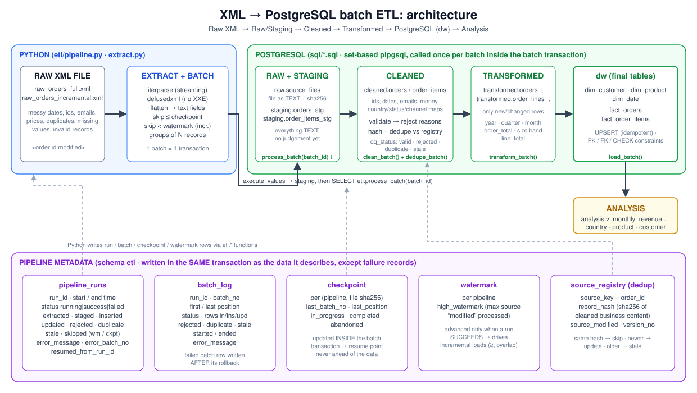

# XML → PostgreSQL batch ETL pipeline

A working, tested ETL pipeline that takes raw, messy **XML** order exports, runs them through
`Raw XML → Raw/Staging → Cleaned → Transformed → PostgreSQL → Analysis`, and loads a clean star schema.

* **SQL** creates the structure and does all the cleaning, validation, de-duplication, transformation and loading.
* **Python** parses the XML, cuts it into batches, drives the SQL one transaction per batch, and records metadata.
* **Full load, incremental load, checkpoint/restart, de-duplication and idempotency** are all implemented and
  each one is demonstrated in [`evidence/`](evidence) with real output.



> Everything below was executed against PostgreSQL 16 / Python 3.12. Numbers quoted in this README are copied from the files in `evidence/`.

---

## Contents
1. [Dataset and XML source](#1-dataset-and-xml-source)
2. [Architecture](#2-architecture)
3. [Repository layout](#3-repository-layout)
4. [Quick start](#4-quick-start)
5. [How the XML is parsed](#5-how-the-xml-is-parsed)
6. [How SQL is used for ETL](#6-how-sql-is-used-for-etl)
7. [How Python automates the process](#7-how-python-automates-the-process)
8. [Batch processing, full load and incremental load](#8-batch-processing-full-load-and-incremental-load)
9. [Checkpointing](#9-checkpointing)
10. [Deduplication](#10-deduplication)
11. [Idempotency](#11-idempotency)
12. [Pipeline metadata](#12-pipeline-metadata)
13. [Error handling and safe restart](#13-error-handling-and-safe-restart)
14. [Validation](#14-validation)
15. [Evidence index](#15-evidence-index)
16. [Design decisions and known limitations](#16-design-decisions-and-known-limitations)

---

## 1. Dataset and XML source

The source simulates a legacy shop system exporting **customer orders** as XML (`data/raw_orders_*.xml`).
It is generated by [`scripts/generate_data.py`](scripts/generate_data.py) with a fixed random seed (re-running gives
byte-identical files; CI checks this). The generator also writes a **ground truth** (`data/expected_*.json`) computed
*independently of the pipeline*, so correctness can be checked against something other than the pipeline's own output.

| File | Records | Purpose |
|---|---|---|
| `data/raw_orders_full.xml` | 1,027 `<order>` | the initial export → **full load** |
| `data/raw_orders_incremental.xml` | 139 `<order>` | the next export → **incremental load** |
| `data/raw_orders_truncated.xml` | cut mid-element | simulates a broken transfer (error demo) |
| `data/expected_full.json`, `expected_incremental.json` | – | ground truth for validation |

Structure (structure is regular; the **values** are messy):

```xml
<orders source="legacy-shop" exported_at="2024-04-01T00:00:00Z">
  <order id="ord-100001" modified="2024-01-01T09:17:28Z">
    <customer><name>Yusuf Anderson</name><email> yusuf.anderson19@example.com </email><country>AU</country></customer>
    <order_date>2024-01-01</order_date><status>complete</status><channel>App</channel>
    <items>
      <item sku="DK-710" qty="1"><name>Standing Desk</name><price> $449.00 </price></item>
      <item sku="CH-720" qty=" 2 "><name>Ergonomic Chair</name><price>329.00</price></item>
    </items>
  </order>
  ...
```

Problems deliberately present in the data and how the pipeline treats them:

| Problem | Examples in the file | Handling |
|---|---|---|
| **Inconsistent formats** | ids `ORD-1`, `ord-1`, `1`, ` ORD-1 `; dates `2024-01-01`, `2024-01-01T10:00:00Z`, `01/31/2024`, `31 Jan 2024`, epoch seconds; prices `$1,299.50`, `1299.5`; qty `2`, `2.0`, ` 2 `; countries `USA`, `U.S.A`, `United States`; statuses `Canceled`, `complete`, ` SHIPPED `; emails in any case | standardised by SQL functions + lookup tables |
| **Missing values** | missing name / country / channel / status (optional) · missing id / email / date / items (required) | optional → `NULL` / `'unknown'`; required → record rejected with a reason |
| **Invalid records** | `not-an-email`, dates `2024-02-30`, `N/A`, `31/31/2024`; qty `-2`, `two`, `0`; price `free`, `-5.00`; empty `<items/>` | **rejected, never dropped silently** – every one has a reason in `cleaned.orders` |
| **Duplicates** | 45 exact re-sends · 30 orders re-sent as a newer version · 12 where the *newer* version comes *first* and the stale one later | de-duplicated (§10) |
| **Late changes / re-exports** (2nd file) | 25 changed orders · 15 identical re-sends with a fresh timestamp · 30 old records re-sent unchanged · 3 repeated new orders | incremental logic (§8) |

Ground truth for the full file: **1,027 records → 900 distinct valid orders, 40 invalid, revenue 660,194.14.**
After the incremental file: **960 orders, revenue 728,924.11.**

---

## 2. Architecture

| Layer | Schema / tables | What happens here |
|---|---|---|
| **Raw XML** | file on disk → `raw.source_files` | The document is archived untouched (as `TEXT`, keyed by SHA-256, so even a malformed file is kept). Same file twice ⇒ one row. |
| **Staging** | `staging.orders_stg`, `staging.order_items_stg` | The extracted fields, **all TEXT**, tagged with run/batch/position. No judgement yet. |
| **Cleaned** | `cleaned.orders`, `cleaned.order_items` | Typed, standardised, validated (`dq_status`/`dq_reason`), content-hashed, de-duplicated. Every staged record gets exactly one row saying what happened to it. |
| **Transformed** | `transformed.orders_t`, `transformed.order_lines_t` | Only records that will be loaded (new or changed), reshaped for analysis: year/quarter/month, order total, size band, line totals. |
| **PostgreSQL (dw)** | `dw.dim_customer`, `dim_product`, `dim_date`, `fact_orders`, `fact_order_items` | Final star schema with PK/FK/CHECK constraints. Loaded by upsert. |
| **Analysis** | `analysis.v_*` views, `sql/24_analysis_queries.sql` | Monthly revenue, revenue by country/channel, top products, customer segments… |
| **Metadata** | `etl.pipeline_runs`, `batch_log`, `checkpoint`, `watermark`, `source_registry` | Run history, resume point, incremental watermark, de-duplication registry. |

Target model (`dw`):

```mermaid
erDiagram
    dim_customer ||--o{ fact_orders : "customer_key"
    dim_date     ||--o{ fact_orders : "date_key"
    fact_orders  ||--|{ fact_order_items : "order_id"
    dim_product  ||--o{ fact_order_items : "product_key"
    dim_customer { int customer_key PK  text email UK  text name  char2 country  date first_order_date }
    dim_product  { int product_key PK  text sku UK  text product_name }
    dim_date     { int date_key PK  date full_date UK  int year  int quarter  int month  bool is_weekend }
    fact_orders  { text order_id PK  int customer_key FK  int date_key FK  text status  text channel  int item_count  numeric order_total  text record_hash  bigint first_loaded_run_id  bigint last_loaded_run_id }
    fact_order_items { text order_id PK_FK  int line_no PK  int product_key FK  int qty  numeric unit_price  numeric line_total }
```

**ELT split of work.** Python does what SQL is bad at (streaming a large XML file, batching, process control);
PostgreSQL does what it is good at (set-based cleaning, de-duplication, joins, constraints). The SQL functions are
the single implementation of the business rules is Python never re-implements them, and each is callable on its own, so
the whole flow can also be run **with no Python at all** (`scripts/run_sql_demo.sh`, where PostgreSQL parses the XML itself
with `xpath()`).

---

## 3. Repository layout

```
data/        raw_orders_full.xml · raw_orders_incremental.xml · raw_orders_truncated.xml · expected_*.json
reference/   country_map.csv · status_map.csv · channel_map.csv           (lookup data, used by SQL and Python)
sql/
  00_reset.sql                 drop everything (demo only)
  01_schema.sql                ALL tables, constraints, indexes, dim_date    (creation + constraints)
  02_reference_data.sql        \copy lookup CSVs (psql only; Python loads the same CSVs itself)
  03_cleaning_functions.sql    one function per cleaning rule
  04_pipeline_functions.sql    clean_batch · dedupe_batch · transform_batch · load_batch · process_batch + metadata helpers
  05_analysis_views.sql        the analysis layer
  10_demo_sql_etl.sql          the whole ETL in pure SQL (xpath), step by step with output
  20_validation.sql            validation queries (counts, duplicates, missing values, loads)
  21_fingerprint.sql           content hash of the warehouse (used to prove "identical result")
  22_metadata_queries.sql · 23_dedup_evidence.sql · 24_analysis_queries.sql
etl/
  extract.py                   streaming XML parser + batching
  pipeline.py                  orchestration, transactions, checkpoint/resume, CLI
  db.py · config.py · validate.py
scripts/     generate_data.py · run_sql_demo.sh · run_demo.sh (regenerates evidence/)
tests/       15 tests (unit + end-to-end against PostgreSQL)
docs/        architecture.svg / .png
evidence/    01 … 11  (real output of every demonstration)
.github/workflows/ci.yml · docker-compose.yml · Makefile · requirements.txt
```

---

## 4. Quick start

```bash
docker compose up -d                      # PostgreSQL 18  (or use any existing instance)
pip install -r requirements.txt
cp .env.example .env && source .env       # DATABASE_URL / PG* variables

python -m etl.pipeline init --reset                                                    # create schemas, functions, reference data
python -m etl.pipeline run data/raw_orders_full.xml        --mode full        --batch-size 100
python -m etl.pipeline run data/raw_orders_incremental.xml --mode incremental --batch-size 50
python -m etl.pipeline validate --expected data/expected_incremental.json

./scripts/run_sql_demo.sh                 # the same ETL in pure SQL, in its own database (needs CREATEDB)
./scripts/run_demo.sh                     # re-creates every file in evidence/   (DESTRUCTIVE to $PGDATABASE)
ETL_TEST_DATABASE_URL=postgresql://…/disposable_db pytest -v
```

CLI: `init [--reset]` · `run SOURCE [--mode full|incremental] [--batch-size N] [--fail-at-batch N] [--purge-staging]` ·
`validate [--expected FILE]` · `abandon SOURCE`. Exit code is `0` on success, `1` on failure.

---

## 5. How the XML is parsed

**Python** ([`etl/extract.py`](etl/extract.py)) uses `iterparse`, a streaming parser: each `<order>` is turned into a
flat record and its subtree is released immediately, so memory stays flat for files of any size. It parses with
**`defusedxml`**, which refuses entity-expansion ("billion laughs") and external-entity (XXE) attacks (tested).
The extractor copies values *as text, exactly as found*; only blank/missing elements become `None`. No cleaning
happens in Python, which keeps the business rules in one place.

Field extraction map:

| XML | → staging column |
|---|---|
| `order/@id`, `order/@modified` | `order_id_raw`, `modified_raw` |
| `customer/name`, `customer/email`, `customer/country` | `customer_*_raw` |
| `order_date`, `status`, `channel` | `order_date_raw`, `status_raw`, `channel_raw` |
| `items/item/@sku`, `@qty`, `name`, `price` | `order_items_stg.sku_raw`, `qty_raw`, `name_raw`, `price_raw` (+ `line_no`) |

Each order also gets its 1-based **position** in the file – the basis for checkpointing.

**SQL** can do the same extraction with no Python: `xpath('/orders/order', raw_content::xml)` explodes the document into
nodes, then `xpath('string(/order/customer/email)', node)` pulls each field (see `sql/10_demo_sql_etl.sql`). Both
routes feed the identical staging tables and the identical downstream SQL.

A malformed file raises `ParseError` *after* the complete records before the defect have been streamed; those are
processed normally, the failure is recorded (§13).

---

## 6. How SQL is used for ETL

### Structure and constraints (`sql/01_schema.sql`)
Seven schemas; PK/FK on every relationship; `CHECK` constraints that encode the business rules in the database itself
(status and channel enumerations, `qty > 0`, `unit_price >= 0`, `order_total >= 0`, `email = lower(email)`,
`item_count > 0`); `UNIQUE` on natural keys (`email`, `sku`, file `sha256`); generated column
`line_total = qty × unit_price`. Even buggy code cannot write an invalid row.

### Cleaning rules (`sql/03_cleaning_functions.sql`)
Each returns `NULL` if the value is missing or unrepairable; validation then decides what `NULL` means.

| Function | Rule |
|---|---|
| `squish` | trim, collapse inner whitespace; `''`, `N/A`, `null`, `none`, `-` … → `NULL` |
| `clean_order_id` | `100001`→`ORD-100001`, ` ord-7 `→`ORD-7`; anything else → `NULL` |
| `clean_email` | lower-case + shape check |
| `proper` | `"  YUSUF   anderson"` → `Yusuf Anderson` |
| `clean_date` | ISO (± time/zone), `MM/DD/YYYY`, `DD Mon YYYY`, epoch seconds; impossible dates (`2024-02-30`) and years outside 2000–2050 → `NULL` |
| `clean_money` / `clean_qty` | `$1,299.50`→`1299.50`; `2.0`→`2`; `free`, `-2`, `two` → `NULL` |
| `clean_ts` | the source `modified` stamp (no zone ⇒ UTC) |
| `norm_country` / `norm_status` / `norm_channel` | lookup in `etl.*_map` (loaded from `reference/*.csv`); unknown status/channel → `'unknown'` |

### Validation (`clean_batch`)
First failing rule wins, and the reason is stored: `missing_order_id` → `invalid_or_missing_email` →
`invalid_or_missing_date` → `no_items` → `invalid_item` (bad sku, qty outside 1–100,000 or price outside 0–10,000,000).
Optional fields never reject a record.

### Transformation (`transform_batch`)
Adds `order_year/quarter/month`, `order_total`, `item_count`, `order_size_band` (small < 250 ≤ medium < 1000 ≤ large),
`line_total`. The warehouse additionally has `dim_date` (weekday, month name, weekend flag) and `first_order_date`.

### Loading (`load_batch`)
`INSERT … ON CONFLICT DO UPDATE` into the dimensions (latest non-null attribute wins; updates only fire when something
actually differs) and `fact_orders`; the order lines of reloaded orders are replaced wholesale (an order may shrink).
The registry row is written last, in the same transaction.

### Pure-SQL demonstration
`./scripts/run_sql_demo.sh` runs [`sql/10_demo_sql_etl.sql`](sql/10_demo_sql_etl.sql) in its own database: it archives the
XML, extracts with `xpath()`, walks **batch 1 through every layer step by step with `SELECT`s between steps**, processes the
remaining batches with `etl.process_batch()`, validates, and runs the analysis queries – first a full load, then an
incremental one. Output: [`evidence/07_pure_sql_etl.txt`](evidence/07_pure_sql_etl.txt).

---

## 7. How Python automates the process

[`etl/pipeline.py`](etl/pipeline.py), per run:

1. take a **session advisory lock** (`pg_try_advisory_lock`) – two runs of one pipeline can never overlap;
2. SHA-256 the file; archive it into `raw.source_files` if that hash is new;
3. look up a **checkpoint** for this file hash (resume?) and the **watermark** (incremental?); open a run row;
4. stream the XML; skip records at/below the checkpoint or below the watermark; group the rest into batches;
5. for each batch run **one transaction** (below);
6. on success: advance the watermark, mark the checkpoint `completed`, close the run row, all in one commit.

The batch transaction ([`_process_batch`](etl/pipeline.py)):

```
BEGIN
  INSERT batch_log row
  execute_values → staging.orders_stg / order_items_stg            (parameterised, bulk)
  SELECT etl.process_batch(batch_id)    -- clean → dedupe → transform → load → batch_log counters
  SELECT etl.save_checkpoint(...)       -- resume point moves in the SAME transaction
COMMIT                                  -- any exception ⇒ ROLLBACK of everything above
```

All SQL from Python is **parameterised** (`%s` placeholders; no string-built queries – the only interpolated identifiers are
constants in `db.py`). Connection settings come from `DATABASE_URL` or the standard `PG*` variables, never from code.

---

## 8. Batch processing, full load and incremental load

**Batches.** Records are processed in controlled groups (`--batch-size`, default 100). A batch is the unit of work,
of atomicity (one transaction) and of recovery. The 1,027-record file ran as 11 batches; the SQL demo uses batches of 250.

| | **Full load** (`--mode full`) | **Incremental load** (`--mode incremental`, default) |
|---|---|---|
| Reads | every record | every record is *parsed*, but only those with `modified ≥ watermark` (or no parseable `modified`) are *staged* |
| Loads | everything not already loaded | only **new** and **changed** records |
| No watermark yet | – | behaves like a full load |
| After success | watermark = max `modified` seen | same (never moves backwards: `GREATEST`) |

Incremental has **two independent filters**:

1. **Watermark** (cheap, early): records with `modified < watermark` are skipped before they reach the database.
   The comparison is `≥`, deliberately overlapping by one boundary record, so equal-timestamp records are never lost.
2. **Content hash** (exact, late): a record that passes the watermark but is byte-for-byte the same business content
   as what is already loaded (e.g. the source re-exported it with a new timestamp) is recognised as a duplicate and
   **not re-loaded** (§10).

Results (real numbers):

| Run | extracted | skipped (watermark) | staged | inserted | updated | duplicate | rejected |
|---|---:|---:|---:|---:|---:|---:|---:|
| **1 · full** (`raw_orders_full.xml`, 11 batches) | 1,027 | 0 | 1,027 | **900** | 25 | 51 | **40** |
| **2 · incremental** (`raw_orders_incremental.xml`, 3 batches) | 139 | **30** | 109 | **60** | **25** | 18 | 6 |

Run 2 touched **85 of 960** fact rows (60 new + 25 changed); the other **875 were not written** (`evidence/03`).
After run 2 the warehouse equals the ground truth exactly: 960 orders, revenue 728,924.11.

> Why `updated=25` and not the 30 versions the generator planted in file 1? When an old and a new version of an order land in
> the *same batch*, the older is discarded inside the batch (`duplicate_in_batch`) and never loaded. How the planted
> duplicates split into *updated / duplicate / stale* therefore depends on batch boundaries – but **inserted = 900,
> rejected = 40 and the final warehouse do not**. A test loads with batch sizes 7, 333 and 5000 and asserts identical results.

---

## 9. Checkpointing

`etl.checkpoint` holds, per (pipeline, **file SHA-256**): `last_batch_no`, `last_position`, `status`
(`in_progress | completed | abandoned`).

* The checkpoint is updated **inside the batch transaction**, so it can never point past data that was not committed
  (nor lag behind it).
* On start, if a checkpoint for the file is `in_progress`, the run **resumes**: records with `position ≤ last_position`
  are skipped (`records_skipped_checkpoint`) and batch numbering continues. The new run row records
  `resumed_from_run_id`. It is position-based, so you may even restart with a different batch size.
* On success the checkpoint becomes `completed`; running that file again starts fresh (and is made harmless by §10/§11).
* A checkpoint belongs to a *file*. If a corrupt file is replaced by a corrected one (new hash), the old checkpoint can
  never be resumed; retire it explicitly with `python -m etl.pipeline abandon <file>` so validation does not report
  unfinished work. The corrected file needs no checkpoint – the dedup registry already knows what was loaded.

Demonstrated in `evidence/05` (injected crash) and `evidence/11` (`kill -9`).

---

## 10. Deduplication

The same *source record* must never be loaded twice. Three layers:

| Layer | Mechanism | Result label (`cleaned.orders.dq_status`) |
|---|---|---|
| **Within a batch** | `row_number() OVER (PARTITION BY order_id ORDER BY modified DESC, position DESC)`; losers dropped | `duplicate_in_batch` (`same_content_repeated` / `superseded_by_newer_version`) |
| **Against history** | every loaded order has a row in `etl.source_registry (source_key, record_hash, source_modified, version_no)`. `record_hash` = SHA-256 of the *cleaned* business content (id, customer, date, status, channel, every line), **excluding** the source timestamp | see below |
| **In the database** | `PRIMARY KEY (order_id)` + `ON CONFLICT DO UPDATE` – last line of defence | – |

Registry decision for each surviving record:

| Registry says | Action | Label |
|---|---|---|
| key never seen | **insert** | `valid` |
| same hash | skip – already loaded | `duplicate_already_loaded` |
| different hash, newer `modified` | **update** (`version_no + 1`) | `valid` |
| different hash, *older* `modified` | skip – out-of-order stale copy | `stale_version` |

Because the hash is over *cleaned* content, `"  YUSUF "` vs `"Yusuf"` or `$449.00` vs `449` are the same record; because it
excludes the timestamp, a re-export with a new `modified` but unchanged content is still a duplicate. Newest-wins is by
`modified`, not by arrival, so an old copy arriving late cannot overwrite a newer one.
Check `#8` of the validation suite asserts no (order, hash) pair was ever loaded twice. Evidence: `evidence/04`.

---

## 11. Idempotency

Running the pipeline again on the same input must not create wrong duplicates or change the result. Achieved by
composition:

* **Natural keys + upserts** everywhere (`ON CONFLICT … DO UPDATE`); dimension updates are skipped when nothing differs.
* **Content-hash registry** – re-sent identical records are classified duplicates and never reach the transformed layer.
* **Order lines are replaced as a set** (delete + insert) for each reloaded order, never appended.
* **Raw archive keyed by SHA-256** – the same file is stored once.
* **Batch atomicity + checkpoint in the same transaction** – a retried batch either happened completely or not at all.

Proof (`evidence/02`): after the first load the same file was run **three more times** (`full`, `incremental`, `full` with a
different batch size). Runs 2–4: **inserted = 0, updated = 0**; warehouse fingerprint (`sql/21_fingerprint.sql`, an MD5 over the
content of every table) **identical** before and after. Also asserted by `test_rerunning_same_file_is_idempotent`.

---

## 12. Pipeline metadata

| Table | Captured |
|---|---|
| `etl.pipeline_runs` | `run_id`, `pipeline_name`, `run_mode`, `source_file`, `file_sha256`, `batch_size`, **`started_at`, `ended_at`, `status`** (`running/success/failed`), **`records_extracted`**, `records_skipped_watermark`, `records_skipped_checkpoint`, `records_staged`, `records_inserted`, `records_updated`, **`records_loaded`** (= inserted+updated, generated), **`records_rejected`**, `records_duplicate`, `records_stale`, `batches_completed`, `resumed_from_run_id`, **`error_message`**, `error_batch_no`, `executed_by` |
| `etl.batch_log` | per batch: run, `batch_no`, first/last position, status, rows in/inserted/updated/rejected/duplicate/stale, start/end, error |
| `etl.checkpoint` · `etl.watermark` · `etl.source_registry` | resume point · incremental high-water mark · dedup registry (§9, §8, §10) |
| `cleaned.orders` | row-level lineage: for *every* staged record its run, batch, file position, outcome and reason (`etl.v_not_loaded` lists all non-loaded records) |
| `dw.fact_orders` | `first_loaded_run_id`, `last_loaded_run_id`, `record_hash` – which run created / last changed each row |

Sample (`evidence/05`, a crashed run and the run that resumed it):

```
 run_id | status  | extracted | skip_cp | staged | ins | upd | rej | dup | stale | batches | resumed_from
      1 | failed  |       400 |       0 |    300 | 290 |   1 |   7 |   1 |     1 |       3 |
      2 | success |      1027 |     300 |    727 | 610 |  24 |  33 |  50 |    10 |       8 |            1
 error: run 1, batch 4: InjectedFailure: simulated crash in batch 4 (positions 301-400) before commit
```

---

## 13. Error handling and safe restart

**Transactions.** One transaction per batch. On *any* exception: the batch is rolled back, the failure is written to
`batch_log` (status `failed`, message) in a **new** transaction, the run row is closed `failed` with `error_message` /
`error_batch_no`, and the process exits `1`. Batches before the failure stay committed.

| Failure | What happens | Recovery |
|---|---|---|
| Exception in a batch (DB error, constraint, bug) | that batch rolled back; earlier batches kept; run `failed`; checkpoint = last good batch | **re-run the same command** → resumes at the next batch |
| Malformed / truncated XML | records before the defect processed; `ParseError` (with line number) recorded; run `failed` | fix/re-deliver the file; re-run. Same file ⇒ resume; new file ⇒ registry skips what was loaded; then `abandon` the old file's checkpoint |
| Process killed (`kill -9`, OOM, power loss) | PostgreSQL rolls back the open batch itself; run row left `running` | re-run: `start_run` marks the dead run `failed: abandoned…`, then the new run resumes from the checkpoint |
| Second run started while one is active | refused (advisory lock) | wait |
| Database unreachable | fails at connect, nothing written | re-run when it is back |
| Invalid *data* | not an error: record rejected with a reason, batch continues | inspect `etl.v_not_loaded` |

**To restart safely:** run the *same command again*. No cleanup, no manual deletes, no flags. Resume is exact
(position-based) and, even if the checkpoint were lost, the registry makes replay harmless.

Demonstrated (each ends with a fingerprint proving the recovered warehouse is **identical** to an uninterrupted load):

* [`evidence/05`](evidence/05_failure_and_checkpoint_resume.txt) – crash injected in batch 4 (`--fail-at-batch 4`): only 290 orders
  loaded, **0** staged rows left from the failed batch, checkpoint at batch 3 / position 300; the re-run reported
  `RESUMING run 2: … batch 3 / position 300`, skipped 300, processed batches 4–11.
* [`evidence/06`](evidence/06_truncated_xml_recovery.txt) – a real fault, an XML file cut mid-element: 6 batches (558 orders)
  committed, run 1 `failed` with `ParseError: no element found: line 4975`; the complete file then loaded the rest.
* [`evidence/11`](evidence/11_hard_kill_sigkill.txt) – `SIGKILL` mid-run: run left `running`, checkpoint at the last
  committed batch, no orphan rows; restart marked it abandoned and resumed.

`--fail-at-batch` is **fault injection** for the demo (it raises after the batch's work, before `COMMIT`); the truncated-XML and
`SIGKILL` cases need no injection.

---

## 14. Validation

`python -m etl.pipeline validate [--expected …]` runs [`sql/20_validation.sql`](sql/20_validation.sql) (also runnable in psql) and
exits non-zero on failure:

| Group | Checks |
|---|---|
| **Record counts** | per run `extracted = skipped + staged` and `staged = inserted + updated + rejected + duplicate + stale` · every staged row has a cleaned row · none left `pending` · `fact_orders = source_registry` |
| **Duplicates** | no duplicate `order_id` / email / sku · no (order, hash) loaded twice · warehouse hash = registry hash |
| **Missing values** | required columns never NULL in facts / dimensions / lines · optional gaps *reported* (e.g. 1 customer without name, 27 orders with channel `unknown`) |
| **Integrity** | `order_total = Σ line_total`, `item_count = #lines` for every order |
| **Successful loads** | no run/batch stuck in `running` · no unfinished checkpoint · failed runs on record |
| **Ground truth** (`--expected`) | order count, **revenue to the cent**, distinct customers, distinct products, orders by status |

Final state (`evidence/09`): **all 16 checks and all 5 ground-truth comparisons pass.**
Tests: `pytest` → **15 passed** (`evidence/10`): XML parsing, XXE refusal, ground-truth full load, idempotency,
incremental, crash→resume, truncated→recover, batch-size independence (7 / 333 / 5000), validation suite.

One further cross-check (`evidence/07`): the **pure-SQL** pipeline (batches of 250/50) and the **Python** pipeline
(batches of 100/50, with a crash and resume in between) produce *byte-identical* warehouses.

---

## 15. Evidence index

| # | File | Proves |
|---|---|---|
| 01 | [`01_full_load.txt`](evidence/01_full_load.txt) | initial full load: 11 batches, 900 inserted, 40 rejected, validation + ground truth |
| 02 | [`02_idempotency.txt`](evidence/02_idempotency.txt) | 3 re-runs: 0 inserted/0 updated, identical fingerprint |
| 03 | [`03_incremental_load.txt`](evidence/03_incremental_load.txt) | 30 skipped by watermark, 60 new + 25 changed, 875 rows untouched |
| 04 | [`04_deduplication.txt`](evidence/04_deduplication.txt) | outcome of every record, one order's copies traced, registry versions |
| 05 | [`05_failure_and_checkpoint_resume.txt`](evidence/05_failure_and_checkpoint_resume.txt) | crash → rollback → checkpoint → resume → identical result |
| 06 | [`06_truncated_xml_recovery.txt`](evidence/06_truncated_xml_recovery.txt) | truncated XML → failed run → recovery via registry |
| 07 | [`07_pure_sql_etl.txt`](evidence/07_pure_sql_etl.txt) | whole ETL in SQL (xpath) + equality with the Python result |
| 08 | [`08_analysis.txt`](evidence/08_analysis.txt) | analysis layer queries on the final tables |
| 09 | [`09_final_validation.txt`](evidence/09_final_validation.txt) | final validation after both loads |
| 10 | [`10_tests.txt`](evidence/10_tests.txt) | pytest, 15 passed |
| 11 | [`11_hard_kill_sigkill.txt`](evidence/11_hard_kill_sigkill.txt) | `kill -9` mid-run → restart |

Regenerate all of it with `./scripts/run_demo.sh`.

---

## 16. Design decisions and known limitations

* **Why hash + watermark?** The watermark alone would silently miss late-arriving records with an old `modified` and would
  re-load re-stamped identical records; the hash alone would re-read everything. Together: cheap skipping plus exact
  correctness. A periodic `--mode full` (safe because it is idempotent) closes the late-arrival gap.
* **Watermark trust.** Incremental relies on the source's `modified` being meaningful. Records without a parseable `modified`
  are *always* processed (never skipped); absurd future timestamps (> now + 1 day) are ignored when advancing the watermark.
* **Deletes** are not detected – the source never says "order removed". Cancellation is a `status`, which is handled.
* **Dimensions are SCD type 1** (latest non-null value overwrites); history is kept in `cleaned.orders`.
* **History grows.** `staging` and `cleaned` keep one row per record per run (full lineage). `--purge-staging` deletes a run's
  staging rows after success; add retention to `cleaned` for production volumes.
* **Raw archive is one `TEXT` cell per file** – fine up to hundreds of MB; for much larger feeds keep the file in object
  storage and store only its path and hash.
* **Re-running a file re-evaluates its invalid rows** (40 rejects appear again in `cleaned`), by design: they are classified, not loaded.
* **`proper()`** uses `initcap`, so `McDonald` → `Mcdonald`; swap in a smarter function if names matter.
* **Single writer** per pipeline (advisory lock). Parallel batch loading would need ordering rules for same-key records across batches.
* **Credentials** in `docker-compose.yml`/`.env.example` are demo values.